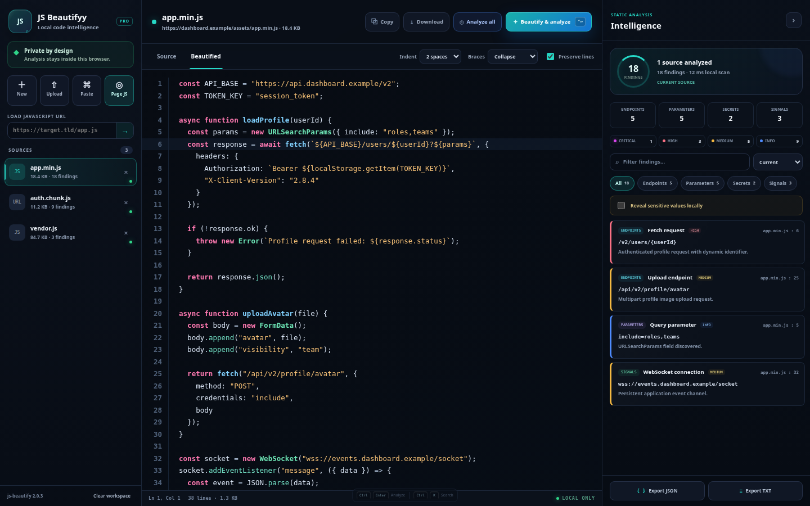
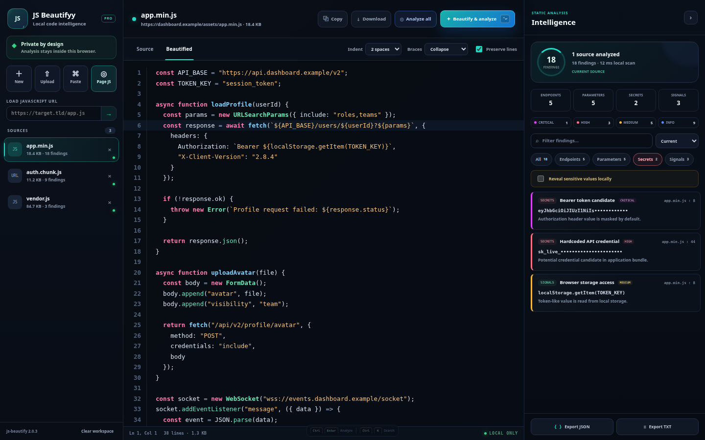

<div align="center">

  

  # JS Beautifyy Pro

  **A private, local-first Chrome workspace for beautifying and statically reviewing JavaScript.**

  [](manifest.json)
  [](manifest.json)
  [](#privacy-and-safety)
  [](#third-party-components)

  [Features](#features) · [Install](#installation) · [Usage](#usage) · [Documentation](#documentation) · [Troubleshooting](#troubleshooting)

</div>

---

## Overview

JS Beautifyy Pro turns minified or difficult-to-read JavaScript into clear,
syntax-highlighted source and maps useful application intelligence without
executing imported code. It is designed for developers, application-security
engineers, and authorized bug-bounty research.

Formatting and analysis run locally inside the extension. There is no analytics,
telemetry, or remote analysis service.

> [!IMPORTANT]
> Results are static indicators for manual review—not proof of a vulnerability.
> Secret detection can produce false positives. Only analyze systems you own or
> are authorized to test.

## Screenshots

### JavaScript intelligence workspace



### Masked secret review



### Extension popup

<p align="center">
  
</p>

## Features

### Code workspace

- Beautifies `.js`, `.mjs`, `.cjs`, and JavaScript stored in `.txt` files.
- CodeMirror 6 editor with JavaScript, TypeScript, and JSX highlighting.
- Line numbers, active-line highlighting, bracket matching, code folding,
  search, undo/redo history, and tab indentation.
- Imports local files, clipboard text, direct HTTP(S) scripts, all scripts from
  the active page, or a JavaScript file opened directly in Chrome.
- Searches and filters findings across one source or the full workspace.
- Exports findings as JSON or TXT and downloads readable source.

### Static intelligence

| Category | Examples detected |
|---|---|
| **Endpoints** | `fetch`, Axios, XHR, WebSocket, EventSource, route definitions, request configurations |
| **URLs** | HTTP(S), WebSocket, absolute network URLs |
| **Parameters** | Query strings, `URLSearchParams`, `FormData`, `req.query`, `req.params`, `req.body`, JSON body keys |
| **Scripts** | Referenced JavaScript assets and chunks |
| **Sensitive paths** | Admin, internal, auth, upload, debug, and configuration paths |
| **Secrets** | API keys, tokens, JWTs, private keys, webhooks, and database connection strings |
| **Signals** | Security-relevant JavaScript sources, sinks, and patterns for manual review |

Potential secrets are masked by default and revealed only through an explicit
local action.

## Installation

### Load the unpacked extension

1. Download and extract [`js-beautifyy-pro-1.4.2.zip`](dist/js-beautifyy-pro-1.4.2.zip).
2. Open `chrome://extensions` in Chrome.
3. Enable **Developer mode**.
4. Select **Load unpacked**.
5. Choose the extracted `js-beautifyy-pro` folder.
6. Pin **JS Beautifyy Pro** from Chrome's Extensions menu.

> Chrome cannot load the ZIP directly with **Load unpacked**. Extract it first.

Press `Alt+Shift+J` to open the full workspace.

## Usage

### Analyze the current website

1. Open an authorized website.
2. Select the extension icon.
3. Press **Analyze page JavaScript**.
4. Use **Beautify & analyze** for the selected source or **Analyze all** for
   every imported source.

### Analyze a directly opened JavaScript file

1. Open a `.js`, `.mjs`, or `.cjs` URL in Chrome.
2. Select the extension icon.
3. Press **Beautify this JavaScript file**.
4. The extension imports, formats, and analyzes the file automatically.

### Analyze a local file

1. Open `chrome://extensions`.
2. Open **Details** for JS Beautifyy Pro.
3. Enable **Allow access to file URLs**.
4. Open the local JavaScript file in Chrome and launch the extension.

You can also open the workspace and use **Upload**.

### Analyze JavaScript stored in TXT

1. Open the workspace.
2. Select **Upload**.
3. Choose the `.txt` file containing JavaScript.
4. Select the imported source.
5. Press **Beautify & analyze**.

Drag-and-drop and clipboard paste are also supported.

### Load a remote script URL

1. Open the workspace.
2. Paste an HTTP(S) JavaScript URL into **Load JavaScript URL**.
3. Press the arrow button.
4. Run **Beautify & analyze**.

Remote retrieval omits cookies and bypasses the browser cache. For an
authenticated script already open in Chrome, analyze the opened tab instead.

## Result workflow

1. Choose a result category or search all findings.
2. Select a finding to jump to its source line.
3. Verify the context manually in the editor.
4. Use **Export JSON** for structured output or **Export TXT** for a readable
   report.
5. Use **Download** to save the current source or beautified code.

## Keyboard shortcuts

| Shortcut | Action |
|---|---|
| `Alt+Shift+J` | Open the workspace |
| `Ctrl+Enter` | Analyze the current source |
| `Ctrl+Shift+Enter` | Analyze all sources |
| `Ctrl+K` | Focus finding search |
| `Ctrl+O` | Upload a file |
| `Ctrl+F` | Search inside the editor |

## Enable or disable

Use the master switch in the popup's top-right corner. When disabled, the
extension blocks page analysis, URL imports, context-menu actions, badges, and
workspace actions until it is enabled again.

## Permissions

| Permission | Why it is needed |
|---|---|
| `activeTab`, `scripting` | Collect script tags after the user requests page analysis |
| `tabs` | Inspect and remember the active normal web tab |
| `storage` | Save preferences and pass a one-time import to the workspace |
| `contextMenus` | Add page and link analysis shortcuts |
| HTTP(S) host access | Fetch scripts explicitly selected by the user |
| `file:///*` | Analyze local JavaScript when file access is enabled in Chrome |

## Privacy and safety

- Imported code is parsed as text and is **never executed** by the extension.
- Formatting and analysis run locally in a dedicated Web Worker.
- No telemetry, analytics, or remote analysis service is used.
- Direct URL and page imports use the network only to retrieve selected scripts.
- Candidate secrets are masked by default.
- Maximum size is 8 MB per source and 24 MB per page scan.

## Documentation

- [Full Markdown documentation](DOCUMENTATION.md)
- [Plain-text documentation](DOCUMENTATION.txt)
- [Chrome extension package v1.4.2](dist/js-beautifyy-pro-1.4.2.zip)

## Development

Requirements: a current Node.js and npm installation.

```bash
npm install --ignore-scripts
npm run build
```

The build vendors pinned dependencies and runs manifest, syntax, asset, and
analyzer smoke checks.

### Project structure

```text
background/   Service worker and Chrome integration
editor/       CodeMirror entry point
popup/        Extension popup
workspace/    Full analysis workspace
workers/      Static-analysis engine
vendor/       Locally bundled runtime dependencies and licenses
scripts/      Build and validation scripts
dist/         Release ZIP archives
```

## Troubleshooting

- **Changes do not appear:** open `chrome://extensions` and press **Reload**.
- **Local file cannot be read:** enable **Allow access to file URLs** in the
  extension's Details page.
- **Authenticated script cannot be fetched:** open the script directly in a tab
  and analyze that tab.
- **Some page scripts are missing:** authentication, CSP, CORS, browser-internal
  pages, and extension-restricted pages can limit collection.
- **A finding looks incorrect:** static detection is intentionally broad; verify
  each result manually.

## Third-party components

- [`js-beautify`](https://github.com/beautifier/js-beautify) 2.0.3 — MIT
- [CodeMirror 6](https://codemirror.net/) — MIT

Dependency licenses are included in `vendor/`.

---

<div align="center">
  <strong>JS Beautifyy Pro v1.4.2</strong><br>
  Local-first JavaScript formatting and static intelligence.
</div>
